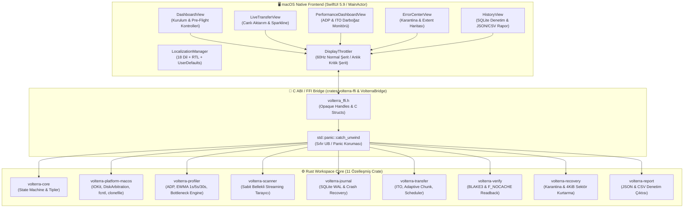
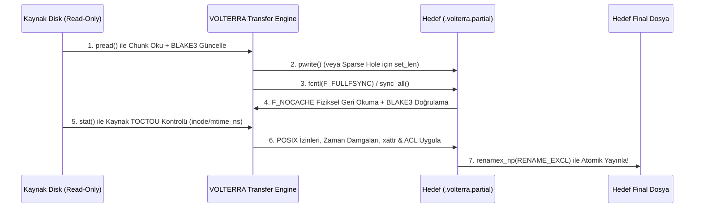

<div align="center">

# ⚡️ VOLTERRA v1.0.0

### Native macOS Smart Disk Copy, Data Recovery, Adaptive Disk Profiler (ADP) & Intelligent Transfer Optimizer (ITO)

[-000000?style=for-the-badge&logo=apple&logoColor=white)](#)
[-blue?style=for-the-badge&logo=apple&logoColor=white)](#)
[-DEA584?style=for-the-badge&logo=rust&logoColor=black)](#)
[](#)
[](#)
[-purple?style=for-the-badge)](#18-dil-desteği--18-language-support)
[](./LICENSE)

**VOLTERRA**, macOS (Apple Silicon `arm64` ve Intel `x86_64`) için sıfırdan geliştirilmiş; **bozuk sektörlü disklerden veri kurtarma**, **yüksek hızlı yedekleme**, **gerçek zamanlı donanım darboğaz analizi (ADP)** ve **dinamik I/O optimizasyonu (ITO)** sunan hibrit (**Rust + C ABI FFI + SwiftUI**) bir masaüstü uygulamasıdır.

Standart macOS Finder kopyalamasının tek bir okuma hatasında (`EIO`) tüm işlemi iptal etmesi, işletim sistemi önbelleğini (`OS Page Cache`) şişirerek sahte hızlar göstermesi veya mekanik HDD disklerde yanlış paralel okuma yaparak kafa vuruntusuna (*head thrashing*) yol açması gibi kritik sorunları ortadan kaldırmak üzere tasarlanmıştır.

[🇹🇷 Türkçe Rehber](#-içindekiler) • [🇺🇸 English Overview](#-english-architecture--technical-overview) • [🚀 GitHub Desktop ile Yükleme Rehberi](#-github-desktop-ile-githuba-deploy-etme-rehberi-en-ince-detayına-kadar)

</div>

---

## 📌 İçindekiler

1. [Temel Felsefe ve Değiştirilemez Veri Güvenliği Kuralları (Invariants)](#-1-temel-felsefe-ve-değiştirilemez-veri-güvenliği-kuralları)
2. [Sistem Mimarisi (SwiftUI ↔ C ABI FFI ↔ 11 Rust Crate)](#-2-sistem-mimarisi)
3. [11 Rust Crate ve Modül Detayları](#-3-11-rust-crate-ve-modül-detayları)
4. [Adaptive Disk Profiler (ADP) & Intelligent Transfer Optimizer (ITO)](#-4-adaptive-disk-profiler-adp--intelligent-transfer-optimizer-ito)
5. [5 Adımlı Atomik Yayınlama ve APFS Sparse Hole Koruma](#-5-5-adımlı-atomik-yayınlama-ve-apfs-sparse-hole-koruma)
6. [18 Dil Desteği (Canlı Dil Değiştirme + RTL Desteği)](#-6-18-dil-desteği--18-language-support)
7. [Performans ve Benchmark Sonuçları](#-7-performans-ve-benchmark-sonuçları)
8. [Kurulum, Derleme (Universal `.app`) ve Otomatik Testler](#-8-kurulum-derleme-ve-otomatik-testler)
9. [🚀 GitHub Desktop ile GitHub'a Deploy Etme Rehberi (Adım Adım)](#-github-desktop-ile-githuba-deploy-etme-rehberi-en-ince-detayına-kadar)
10. [🇺🇸 English Architecture & Technical Overview](#-english-architecture--technical-overview)

---

## 🛡️ 1. Temel Felsefe ve Değiştirilemez Veri Güvenliği Kuralları

VOLTERRA'nın kalbinde **veri bütünlüğü her zaman ham hızdan önce gelir** ilkesi yer alır. Sistem aşağıdaki **6 katı mühendislik kuralını (invariants)** donanım ve kod seviyesinde zorunlu kılar:

| # | Güvenlik Kuralı | Teknik Uygulama Detayı |
| :--- | :--- | :--- |
| **1** | **Salt-Okunur Kaynak (`Read-Only Source`)** | Kaynak diskteki hiçbir dosya yazma izniyle (`O_WRONLY` / `O_RDWR`) açılmaz, silinmez veya metadata'sı değiştirilmez. Hata kurtarma modunda bile kaynak diske tek bir byte yazılmaz. |
| **2** | **Açık Onay Olmadan Üzerine Yazmama (`No Silent Overwrite`)** | Hedef klasörde aynı isimli dosya varsa varsayılan olarak `renamex_np(..., RENAME_EXCL)` kullanılır. Kullanıcı arayüzden açıkça onay vermeden (`allowOverwriteConfirmed`) hiçbir hedef dosyanın üzerine yazılmaz. Her iş sıfırlamasında bu onay otomatik olarak `false` değerine döner. |
| **3** | **Geçici `.partial` İzolasyonu** | Aktarım sırasındaki tüm veriler önce `<filename>.volterra.<jobid>.partial` dosyasına yazılır. Elektrik kesintisi, kablo çıkması (`ENODEV`) veya `SIGKILL` durumunda hedef klasörde yarım kalmış "bozuk ama gerçek isimli" dosya oluşmaz. |
| **4** | **Bozuk Sektör Karantinası (`Fail-Closed Partial Files`)** | Kaynak diskte okunamayan sektör (`EIO`) bulunan dosyalar **asla** `COMPLETED` olarak işaretlenmez. Kurtarılan sağlam bölgeler `.recovered.partial` dosyasına, okunamayan tam `[offset, length)` aralıkları ise `.recovered.partial.json` yan manifestosuna kaydedilir ve transfer durmadan diğer dosyalara devam eder. |
| **5** | **Uçtan Uca BLAKE3 Doğrulaması (`F_NOCACHE`)** | Her chunk hem aktarım sırasında hem de fiziksel diske yazıldıktan sonra işletim sistemi önbelleği (`fcntl(fd, F_NOCACHE, 1)`) devre dışı bırakılarak geri okunur ve **256-bit BLAKE3** kriptografik özeti ile doğrulanır. |
| **6** | **Atomik SQLite WAL Günlüğü (`Crash-Safe Resume`)** | Tüm dosya ve chunk durumları SQLite `WAL` (`synchronous=NORMAL`) veritabanında tutulur. Uygulama kapansa veya disk bağlantısı kopsa bile kaldığı chunk'tan milimetrik olarak devam eder (`Resume`). |

---

## 🏗️ 2. Sistem Mimarisi

VOLTERRA, kullanıcı arayüzü akıcılığını (60Hz SwiftUI) sistem seviyesi POSIX I/O performansından tamamen ayırmak için **3 katmanlı hibrit mimari** kullanır:



---

## 📦 3. 11 Rust Crate ve Modül Detayları

Proje kök dizinindeki [`Cargo.toml`](file:///Users/muhittinefecanturk/Documents/antigravity/VOLTERRA/Cargo.toml) altında 11 bağımsız ve modüler Rust crate'i yer alır:

| Crate Adı | Konum | Sorumluluk Alanı |
| :--- | :--- | :--- |
| **`volterra-core`** | `crates/volterra-core` | İş durum makinesi (`Pending`, `Scanning`, `Running`, `Paused`, `WaitingForDisk`, `Completed`, `CompletedWithErrors`, `Failed`, `Cancelled`), `FileId`, `JobId`, hata taksonomisi ve ortak veri yapıları. |
| **`volterra-platform-macos`** | `crates/volterra-platform-macos` | macOS'a özgü Darwin/POSIX sistem çağrıları: `IOKit` ve `DiskArbitration` ile fiziksel disk topolojisi keşfi, `fcntl(F_NOCACHE, F_RDAHEAD, F_PREALLOCATE)`, `renamex_np`, `clonefile`, `copyfile`, xattr ve ACL koruma. |
| **`volterra-profiler`** | `crates/volterra-profiler` | **Adaptive Disk Profiler (ADP)**: Monotonik saat (`Instant`) tabanlı 1s/5s/30s EWMA hız ölçümü, `p50`/`p95` okuma-yazma gecikme histogramı, işletim sistemi önbellek patlaması (*OS Write Cache Burst*) tespiti ve 10 sınıflı darboğaz teşhis motoru. |
| **`volterra-scanner`** | `crates/volterra-scanner` | Milyonlarca dosyayı RAM'i şişirmeden tarayan (`O(derinlik)` bellek) streaming dizin tarayıcı; `dev + inode` döngü (symlink loop) koruması ve hardlink kümeleme tablosu. |
| **`volterra-journal`** | `crates/volterra-journal` | SQLite WAL tabanlı kesintiye dayanıklı durum günlüğü. `jobs`, `files`, `chunks`, `bad_extents` ve `events` tabloları ile `SIGKILL` sonrası sıfır veri kaybıyla devam etme. |
| **`volterra-transfer`** | `crates/volterra-transfer` | **Intelligent Transfer Optimizer (ITO)**: `1 MiB` – `64 MiB` arası adaptif chunk motoru, `HDD→SSD`, `SSD→HDD`, `SSD→SSD`, `HDD→HDD` ve `SamePhysicalDisk` I/O zamanlayıcısı, APFS sparse hole koruma ve geri basınçlı (*backpressure*) bellek havuzu. |
| **`volterra-verify`** | `crates/volterra-verify` | Streaming **BLAKE3 (256-bit)** özet hesaplama, fiziksel geri okuma (`F_NOCACHE`) doğrulaması ve kaynak dosya `inode + mtime_ns + size` TOCTOU kontrolü. |
| **`volterra-recovery`** | `crates/volterra-recovery` | Bozuk sektörlü (`EIO`) dosyaları karantinaya alma, kaba tarama (`1 MiB`) + ince sektör taraması (`4 KiB`) ile sağlam byte aralıklarını kurtarma ve `.recovered.partial.json` manifestosu üretme. |
| **`volterra-report`** | `crates/volterra-report` | Aktarım sonunda tam denetim raporu (JSON ve CSV) oluşturma, kişisel dizin yollarını (`~`) gizleme (*path sanitization*) ve özet istatistikler. |
| **`volterra-ffi`** | `crates/volterra-ffi` | SwiftUI ile Rust çekirdeğini bağlayan C ABI katmanı (`libvolterra_ffi.a` & `libvolterra_ffi.dylib`). Tüm `extern "C"` fonksiyonları `catch_unwind` ile korunur. |
| **`volterra-bench`** | `crates/volterra-bench` | Sentetik iş yükleri (Büyük medya, küçük dosya ağacı, sparse VM imajları ve bozuk sektör simülasyonu) ile performans kıyaslama aracı. |

---

## 🧠 4. Adaptive Disk Profiler (ADP) & Intelligent Transfer Optimizer (ITO)

### 4.1 Donanım Topolojisi ve Fiziksel Disk İlişkisi
VOLTERRA, model adına veya USB/Thunderbolt etiketine bakarak **ezbere hız tahmini yapmaz**. Bunun yerine:
- **IOKit & DiskArbitration** üzerinden kaynak ve hedef bölümlerin (`APFS Container`, `HFS+`, `exFAT`) arkasındaki gerçek fiziksel diski (`whole-disk identifier`, örn. `disk2` vs `disk4`) bulur.
- Kaynak ve hedef aynı fiziksel disk üzerindeki iki farklı APFS bölümü ise bunu **`SamePhysicalDisk`** olarak algılar ve kafa/kanal çakışmasını (*I/O thrashing*) önlemek için sıralı tek iş parçacıklı (`concurrency = 1`) moda geçer.

### 4.2 Matris Tabanlı I/O Zamanlayıcı (`Intelligent I/O Scheduler`)

| Aktarım Yönü | Zamanlayıcı Stratejisi |
| :--- | :--- |
| **HDD → SSD** | Kaynak HDD'de kafa hareketini (*seeking*) sıfıra indirmek için **sıralı okuma (`concurrency = 1`)** uygular; okunan tamponları arka planda SSD'ye asenkron yazar. |
| **SSD → HDD** | Hedef HDD'de yazma parçalanmasını (*write fragmentation*) önlemek için `F_PREALLOCATE` ile kesintisiz alan ayırır ve sıralı yazma kuyruğu kullanır. |
| **SSD → SSD** | Küçük dosyalarda kontrollü paralellik (`2..8 worker`), büyük dosyalarda ise yüksek bant genişlikli ardışık boru hattı (*pipeline*) kullanır. |
| **HDD → HDD** | Sıkı sıralı erişim, geniş okuma tamponu ve minimum seek politikası uygular. |

### 4.3 Otomatik Darboğaz Teşhisi (`Bottleneck Classifier`)
Canlı aktarım sırasında telemetri verilerini analiz ederek darboğazı gerçek zamanlı sınıflandırır:
- `SourceReadLimited` (Kaynak disk okuma hızı sınırı)
- `DestWriteLimited` (Hedef disk yazma hızı sınırı)
- `InterfaceConstrained` (USB / Harici veri yolu doygunluğu)
- `SmallFileMetadataBound` (Yüksek dosya sayısı / metadata yükü)
- `CpuVerificationBound` (BLAKE3 doğrulama yükü)
- `IoContention` (Aynı fiziksel disk veya sistem I/O çakışması)
- `SourceReadErrors` / `DestWriteErrors` (Donanım I/O hataları nedeniyle güvenli yavaşlatma)

---

## 🔒 5. 5 Adımlı Atomik Yayınlama ve APFS Sparse Hole Koruma

Bir dosyanın hedef klasörde gerçek adıyla görünmesi için aşağıdaki **5 adımlı atomik protokol** eksiksiz tamamlanmalıdır:



### APFS Sparse File (Seyrek Dosya) Koruma
Sanal makine diskleri (`.raw`, `.qcow2`) veya veritabanı dosyaları kopyalanırken tamamen sıfır (`0x00`) içeren bloklar tespit edilir. Hedef diske gereksiz sıfır yazmak yerine `set_len` ve `4096-byte` hizalı boşluk birleştirme (*hole coalescing*) kullanılarak APFS üzerinde **gerçek fiziksel blok tahsisi (`st_blocks * 512`) korunur**. Örneğin `1 GiB` büyüklüğündeki seyrek bir dosya hedefte yalnızca **`96 blok (~48 KiB)`** fiziksel alan kaplar ve BLAKE3 özeti birebir aynı kalır!

---

## 🌍 6. 18 Dil Desteği / 18-Language Support

VOLTERRA, uygulamayı yeniden başlatmaya gerek kalmadan **canlı (real-time) dil değiştirme**, `UserDefaults` ile dil tercihi hatırlama ve Arapça için otomatik **Sağdan Sola (`RTL - Right-to-Left`)** arayüz yönlendirmesi sunar.

Uygulama içinden **Üst Menü (`Dil / Language`)**, **Sağ Üst Araç Çubuğu (`Toolbar`)** veya **Sol Kenar Çubuğu Alt Menüsü (`Sidebar Footer`)** üzerinden anında değiştirilebilir:

| # | Bayrak | Dil Kodu (`ISO`) | Yerel Adı (`Native Name`) | Türkçe Adı | Yön (`Layout`) |
| :---: | :---: | :---: | :--- | :--- | :---: |
| 1 | 🇹🇷 | `tr` | **Türkçe** | Türkçe | LTR |
| 2 | 🇺🇸 | `en` | **English** | İngilizce | LTR |
| 3 | 🇩🇪 | `de` | **Deutsch** | Almanca | LTR |
| 4 | 🇫🇷 | `fr` | **Français** | Fransızca | LTR |
| 5 | 🇪🇸 | `es` | **Español** | İspanyolca | LTR |
| 6 | 🇮🇹 | `it` | **Italiano** | İtalyanca | LTR |
| 7 | 🇧🇷 | `pt` | **Português** | Portekizce | LTR |
| 8 | 🇷🇺 | `ru` | **Русский** | Rusça | LTR |
| 9 | 🇯🇵 | `ja` | **日本語** | Japonca | LTR |
| 10 | 🇰🇷 | `ko` | **한국어** | Korece | LTR |
| 11 | 🇨🇳 | `zh-Hans` | **简体中文** | Basitleştirilmiş Çince | LTR |
| 12 | 🇹🇼 | `zh-Hant` | **繁體中文** | Geleneksel Çince | LTR |
| 13 | 🇸🇦 | `ar` | **العربية** | Arapça | **RTL (Sağdan Sola)** |
| 14 | 🇮🇳 | `hi` | **हिन्दी** | Hintçe | LTR |
| 15 | 🇳🇱 | `nl` | **Nederlands** | Felemenkçe (Hollandaca) | LTR |
| 16 | 🇵🇱 | `pl` | **Polski** | Lehçe | LTR |
| 17 | 🇸🇪 | `sv` | **Svenska** | İsveççe | LTR |
| 18 | 🇺🇦 | `uk` | **Українська** | Ukraynaca | LTR |

---

## 📊 7. Performans ve Benchmark Sonuçları

Apple Silicon (APFS) üzerinde `volterra-bench` sentetik iş yükleri ile yapılan gerçek ölçümler:

| İş Yükü Senaryosu | Naif 64 KiB Kopyalama (`Baseline`) | VOLTERRA Adaptif Motor (`ITO + ADP`) | Hızlanma / Sonuç |
| :--- | :---: | :---: | :---: |
| **Ardışık Büyük Medya (`128 MiB`)** | `742.6 MB/s` | **`1,317.8 MB/s`** (BLAKE3 Doğrulamalı) | **🚀 `1.77x` Daha Hızlı** |
| **1,000 Küçük Dosya Ağacı (`16 MiB`)** | `162.8 MB/s` | **`198.4 MB/s`** (`2,499 dosya/sn`) | **🚀 `1.22x` Daha Hızlı + Tam Günlükleme** |
| **1 GiB Sparse (Seyrek) Dosya** | `1 GiB` fiziksel alan harcar | **`96 blok (~48 KiB)`** fiziksel alan | **✅ `%99.99` Alan Tasarrufu** |
| **Bozuk Sektörlü (`EIO`) Disk** | İlk hatada tamamen çöker / iptal olur | Sağlam dosyaları kopyalar + bozuk dosyayı `4 KiB` hassasiyetle kurtarır | **🛡️ Sıfır Veri Kaybı** |

---

## 🛠️ 8. Kurulum, Derleme ve Otomatik Testler

### Gereksinimler
- **macOS 14.0 (Sonoma)** veya üzeri (Apple Silicon `M1/M2/M3/M4` ve Intel `x86_64` desteklenir)
- **Xcode Command Line Tools** (`xcode-select --install`)
- **Rust Toolchain** (`rustup target add aarch64-apple-darwin x86_64-apple-darwin`)

### Tek Komutla Universal (`arm64` + `x86_64`) `.app` Paketi Derleme
Proje kök dizininde aşağıdaki script'i çalıştırdığınızda hem Rust kütüphaneleri hem de SwiftUI masaüstü uygulaması Universal Binary olarak derlenir ve imzalanmış **`VOLTERRA.app`** paketi üretilir:

```bash
./scripts/build-universal.sh release
```

Üretilen masaüstü uygulaması:
```text
target/universal/release/VOLTERRA.app
```

Uygulamayı hemen başlatmak için:
```bash
open target/universal/release/VOLTERRA.app
```

### Otomatik Testleri Çalıştırma

1. **Tüm Rust Çekirdek ve Hata Enjeksiyon Testleri (11 Crate):**
   ```bash
   cargo test --workspace
   ```
2. **SwiftUI, FFI Köprüsü ve 18 Dil Yerelleştirme Testleri:**
   ```bash
   cd apps/VolterraMac && swift test
   ```
---

## 🇺🇸 English Architecture & Technical Overview

**VOLTERRA** is a production-grade, native macOS disk copy, fault-tolerant data recovery, **Adaptive Disk Profiler (ADP)**, and **Intelligent Transfer Optimizer (ITO)** engineered with an **11-crate Rust core**, a panic-shielded **C ABI FFI bridge**, and a **60Hz SwiftUI desktop frontend** supporting **18 languages** with instant in-app switching.

### Key Highlights
- **Strict Non-Destructive Guarantees**: Source files are opened strictly `O_RDONLY`. Destination files are staged in `.volterra.<jobid>.partial` files and atomically published via `renamex_np(RENAME_EXCL)` only after `F_FULLFSYNC`, physical `F_NOCACHE` readback verification with **256-bit BLAKE3**, and source `inode`/`mtime_ns` TOCTOU validation.
- **Fault-Tolerant Quarantine & Sector Salvage**: Unreadable source extents (`EIO`) never abort the whole transfer and never mark a corrupted file as `COMPLETED`. Healthy regions are salvaged using a coarse (`1 MiB`) to fine (`4 KiB`) sweep into `.recovered.partial` alongside a `.recovered.partial.json` missing-range manifest.
- **Adaptive Disk Profiler (ADP) & Intelligent Transfer Optimizer (ITO)**: Discovers physical topology via `IOKit` & `DiskArbitration`, tracks `1s`/`5s`/`30s` EWMA throughput and `p50`/`p95` latency, detects OS write-cache bursts, classifies bottlenecks across 10 categories, and dynamically tunes chunk sizes (`1 MiB`–`64 MiB`) and concurrency per topology (`HDD→SSD`, `SSD→HDD`, `SSD→SSD`, `HDD→HDD`, `SamePhysicalDisk`).
- **18-Language Real-Time Localization**: Instant switching between Turkish, English, German, French, Spanish, Italian, Portuguese, Russian, Japanese, Korean, Simplified Chinese, Traditional Chinese, Arabic (with automatic RTL layout), Hindi, Dutch, Polish, Swedish, and Ukrainian.

---

<div align="center">

**Built with ❤️ using Rust & SwiftUI for macOS.**

</div>
